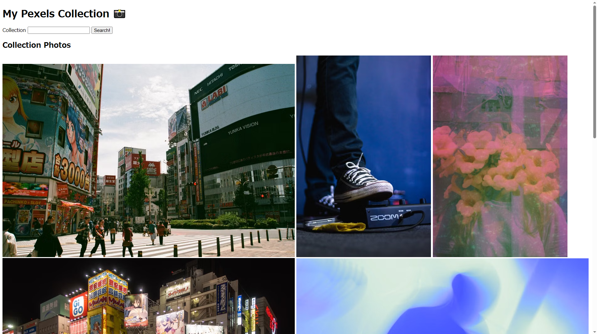

# Pexels API

This is the project from [The Odin Project](https://www.theodinproject.com/) curriculum — a simple photo gallery application built with **Ruby on Rails**, focusing on consuming an external API, HTTP requests, API clients, and handling JSON responses.

## Preview



## Features

- Enter a Pexels collection ID
- Fetch photos from a Pexels collection
- Display photos from the collection
- Handle API requests with HTTParty
- Store API credentials securely with Rails Credentials

## Skills Learned

### Ruby on Rails

- Creating custom API client classes
- Separating external API logic from controllers
- Using `params` from GET requests
- Using Rails Credentials for API keys
- Displaying API data in views
- Using `form_with` with GET requests

### API

- Consuming an external REST API
- Making HTTP requests with **HTTParty**
- Setting HTTP request headers
- Authenticating API requests with an API key
- Parsing JSON responses with `parsed_response`
- Working with nested JSON data
- Filtering API data based on its type

## API Example

A request to:

```http
GET /v1/collections/9mp14cx
Authorization: YOUR_API_KEY
```

returns collection data containing photos and videos:

```json
{
  "id": "9mp14cx",
  "media": [
    {
      "type": "Photo",
      "id": 2061057,
      "src": {
        "medium": "https://images.pexels.com/..."
      }
    }
  ]
}
```

The application extracts the media array, filters for photos, and displays them in the gallery.

## Challenges

- Creating a custom API client with HTTParty
- Understanding base_uri and request options
- Storing the Pexels API key with Rails Credentials
- Working with nested JSON responses
- Understanding parsed_response
- Passing collection IDs from a form to the controller
- Separating API communication from controller logic
